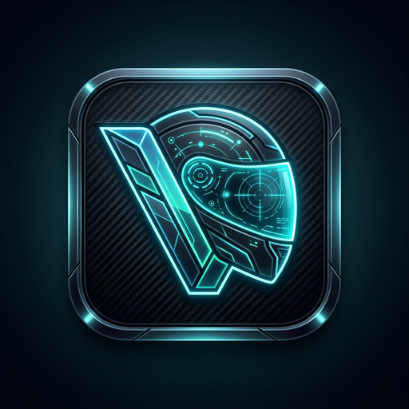
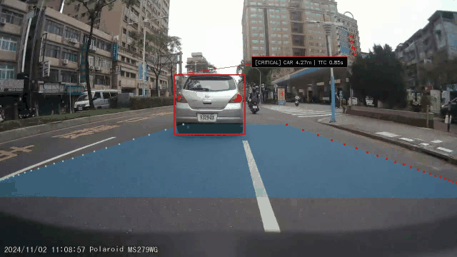
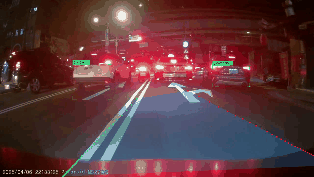
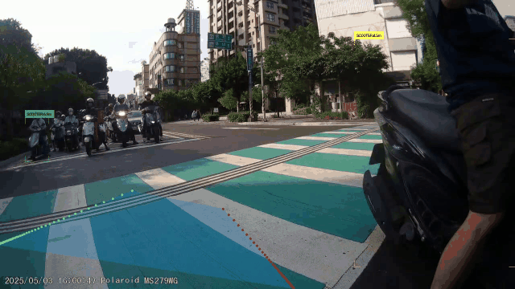
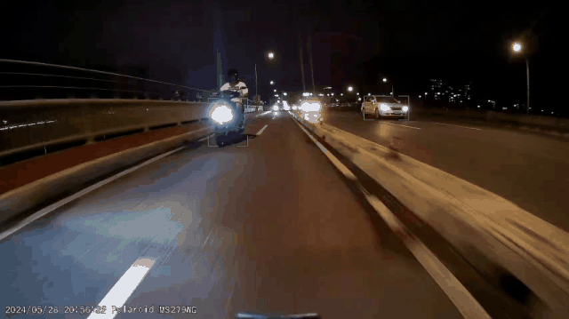
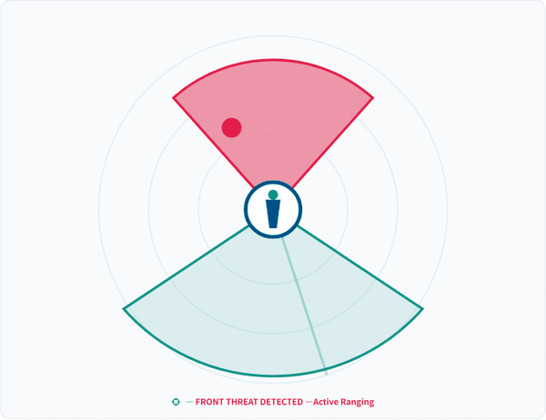
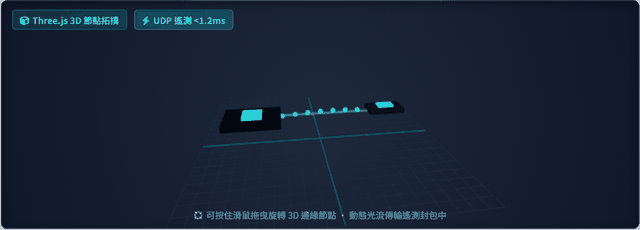
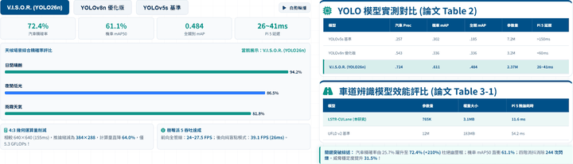
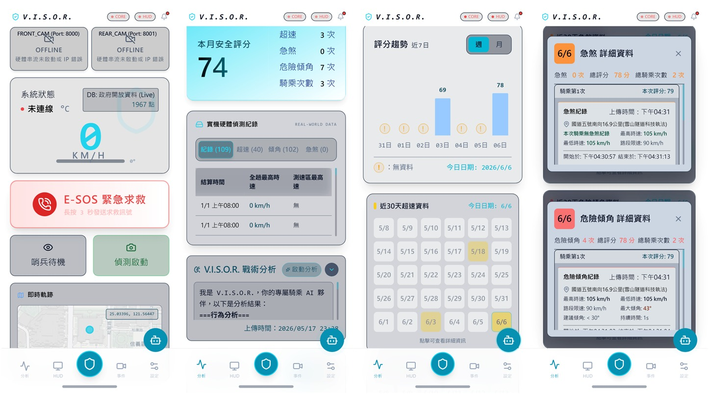
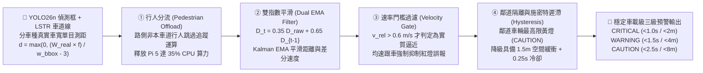

<div align="center">



# V.I.S.O.R.
### **V**isual **I**ntelligent **S**afety **o**n **R**oad
### 智慧視覺機車安全行車輔助系統
**Advanced Rider Assistance with Visual Intelligent Safety on Road**

[](#)
[](#)
[-005CED?style=for-the-badge&logo=onnx&logoColor=white)](#)
[](#)
[](#)

<p align="center">
  <strong>🌐 Language / 語言導覽：</strong>
  <a href="#-實車道路實測與系統動態展示-live-road-test--visual-showcase">🎬 動態實測展示 (Visual Showcase)</a> •
  <a href="#-繁體中文說明文件-traditional-chinese">🇹🇼 繁體中文完整說明</a> •
  <a href="#-english-documentation-v-i-s-o-r">🇺🇸 English Documentation</a> •
  <a href="#-快速啟動與部署指南-quick-start--deployment">🚀 快速啟動 (Quick Start)</a>
</p>

---

| 🛡️ **全景盲區覆蓋 (Panoramic FOV)** | ⚡ **純 CPU 邊緣延遲 (Edge Latency)** | 🧠 **極致輕量模型 (YOLO26n-TW)** | 🔋 **車載低功耗 (Power Draw)** |
| :---: | :---: | :---: | :---: |
| **280°** (`Front 120° + Rear 173°`) | **26 – 41 ms** (`24–39 FPS`) | **2.37M Params** (`5.3 GFLOPs`) | **< 15 W** (`12V 機車電瓶直驅`) |

</div>

---

## 🎬 實車道路實測與系統動態展示 (Live Road-Test & Visual Showcase)

> **V.I.S.O.R. (Visual Intelligent Safety on Road)** 於真實道路行車紀錄影像（1280×720 原始輸入、4:3 原生幾何 `384×288` 推論）之端到端即時視覺感知成果。系統同步執行 **YOLO26n 台灣車流物件偵測**、**LSTR / CV-Magnet 車道線擬合**、**單目物理車寬測距** 與 **四階邊緣消抖防護引擎 (4-Stage Sentinel Engine)**。
>
> *End-to-end real-road validation of **V.I.S.O.R.** running on 1280×720 dashcam footage with native 4:3 rectangular inference (`384×288`), combining **YOLO26n object detection**, **LSTR / CV-Magnet lane fitting**, **monocular distance estimation**, and the **4-Stage Sentinel De-jitter Engine**.*

### 1. 四大真實道路情境實測矩陣 (4-Scenario Real-Road Validation Matrix)

<table>
  <tr>
    <td width="50%" align="center">
      
      <br />
      <b>🏙️ 場景一：市區密集混合車流實測 (24.2 FPS)</b><br />
      <sub><i>Scene 1: Dense Urban Mixed Traffic — Multi-scooter tracking & ego-lane gating</i></sub>
    </td>
    <td width="50%" align="center">
      
      <br />
      <b>🛣️ 場景二：快速道路高架高速實測 (27.5 FPS)</b><br />
      <sub><i>Scene 2: Expressway High-Speed Cruising — Long-range LSTR curve prediction & TTC</i></sub>
    </td>
  </tr>
  <tr>
    <td width="50%" align="center">
      
      <br />
      <b>🏍️ 場景三：車流穿梭超車動態追蹤 (1.5× Speed)</b><br />
      <sub><i>Scene 3: Dynamic Weaving & Overtaking — Schmitt hysteresis anti-flicker protection</i></sub>
    </td>
    <td width="50%" align="center">
      
      <br />
      <b>🚨 場景四：後方盲區逼近防碰撞預警 (39.1 FPS)</b><br />
      <sub><i>Scene 4: Rear Blind-Spot Approaching — Rapid TTC < 1.0s CRITICAL alert triggering</i></sub>
    </td>
  </tr>
</table>

---

### 2. 核心架構與視覺化感知展示 (Core Architecture & Perception Visuals)

<table>
  <tr>
    <td width="33%" align="center">
      
      <br />
      <b>📡 280° 全景盲區雷達與動態威脅分區</b><br />
      <sub><i>280° Panoramic FOV & Threat Zone Partitioning</i></sub>
    </td>
    <td width="33%" align="center">
      
      <br />
      <b>🖧 分散式雙節點邊緣運算解耦架構</b><br />
      <sub><i>Decoupled Dual-Node Edge Computing (Pi 5 + Pi Zero 2W)</i></sub>
    </td>
    <td width="33%" align="center">
      
      <br />
      <b>📊 V.I.S.O.R. 全天候精準度與效能基準</b><br />
      <sub><i>All-Weather Precision & Edge Latency Benchmark</i></sub>
    </td>
  </tr>
</table>

---

### 3. V.I.S.O.R. 戰術行動端應用程式介面 (Tactical Mobile App Interface)

<div align="center">
  
  <p>
    <sub>
      <b>▲ V.I.S.O.R. 行動端四大核心畫面 (Four Core Mobile Screens)：</b>
      (1) 雙鏡頭即時串流、系統狀態、E-SOS 緊急求救與哨兵待機主控台；
      (2) 本月安全評分、實機硬體偵測紀錄與 AI 戰術行為分析；
      (3) 近 7 日評分趨勢與近 30 天超速熱力日曆；
      (4) 急煞與危險傾角事件之詳細時空座標與路段限速對照卡。
    </sub>
  </p>
</div>

---

# 🇹🇼 繁體中文說明文件 (Traditional Chinese)

## 📌 一、研究背景與系統定位 (Background & Overview)

在高密度混合車流的台灣道路環境中，機車登記數超過 1,440 萬輛，機車騎士是最顯著的**弱勢道路使用者 (Vulnerable Road Users, VRUs)**。根據交通部統計，台灣交通事故死傷中機車涉入率高達 **61.74%**，且由於缺乏剛性車體保護，機車事故致死率高達小客車的 **28 倍**。然而，市售汽車級 ADAS（先進駕駛輔助系統）仰賴昂貴的光達、毫米波雷達與高功耗 GPU，因成本與體積限制無法普及於一般二輪載具。

為推動**「交通平權 (Traffic Equity) — 主動安全不是汽車的特權」**，本研究提出 **V.I.S.O.R. (Visual Intelligent Safety on Road，智慧視覺機車安全行車輔助系統)**：
* **純視覺低成本主動防護盾**：結合前向 120° 廣角與後向 173° 超廣角星光級雙鏡頭（Sony IMX662 STARVIS 2），實現近 **280° 無盲區全景覆蓋**。
* **分散式雙節點硬體解耦**：將「AI 視覺推論（車身 Raspberry Pi 5）」與「安全帽光學抬頭顯示（Raspberry Pi Zero 2W + I2C OLED）」實體解耦，透過微秒級 UDP 廣播/單播協議（`<1.2ms` 網路延遲）同步，徹底根除資源爭用、掉幀與畫面撕裂。
* **直覺零認知負荷人機介面 (Minimalist HMI)**：將複雜的道路空間運算濃縮為安全帽反射片上的**極簡四向方向箭頭、硬體反白閃爍警示與雙頻蜂鳴器提示**，搭配 **Android 戰術行動端 App** 與 **Supabase 雲端大數據分析**，在事發前提供毫秒級預警。

---

## 🏗️ 二、系統架構與管線流程圖 (System Architecture & Pipeline Diagrams)

### 2.1 端到端硬體與異質網路拓樸 (End-to-End Hardware & Network Topology)

```mermaid
flowchart TB
    subgraph Sensors["📷 星光級雙鏡頭感測層 (Dual STARVIS 2 Cameras)"]
        CamFront["前向廣角鏡頭 (Front ADAS Cam)<br/>Sony IMX662 STARVIS 2<br/>FOV 120° | f = 260 px"]
        CamRear["後向超廣角鏡頭 (Rear BSD Cam)<br/>Sony IMX662 STARVIS 2<br/>FOV 173° | f = 185 px"]
    end

    subgraph Pi5["🧠 V.I.S.O.R. Core 車載運算中樞 (Raspberry Pi 5 — 8GB RAM)"]
        FrameReader["FrameReader 雙路非同步擷取<br/>V4L2 VIDIOC_QUERYCAP 節點過濾與防衝突"]
        Scheduler["Asymmetric Ping-Pong 排程器<br/>20Hz 雙鏡頭交替推論 + 後方危險優先鎖定"]
        
        subgraph AIPipeline["VisorCore 邊緣視覺感知與四階消抖管線"]
            Preproc["4:3 原生幾何前處理 (384×288)<br/>CLAHE 自適應均衡 + 算力節省 64%"]
            YOLO["YOLO26n-TW Titan (2.37M)<br/>5 類別台灣混流偵測 + P3 小目標強化"]
            Lane["輕量車道線感知引擎<br/>CV-Magnet (0.4ms) / LSTR (11.6ms)"]
            Sentinel["SpatialFusion v2 四階邊緣消抖引擎<br/>①行人分流 ➔ ②雙指數 EMA ➔ ③速率門檻 ➔ ④施密特遲滯"]
        end

        Recorder["DashcamRecorder 哨兵循環錄影<br/>環形緩衝區 + 傾角/衝擊事件鎖檔"]
        TripLogger["TripLogger 車載黑盒子<br/>非同步佇列 CSV 路測紀錄 (<0.1% CPU)"]
        
        CommHub["多協定容錯通訊匯流排 (Dual-Channel Comm Hub)<br/>WebSocket (:8765) | BT RFCOMM (Ch.1) | UDP (:5005/:5006)"]
    end

    subgraph PiZero["🥽 V.I.S.O.R. HUD 抬頭顯示節點 (Raspberry Pi Zero 2W)"]
        HudClient["HudClient 三執行緒零積壓引擎<br/>多路單播/廣播心跳回報 (pi5.local / 192.168.4.1)"]
        OLED["1.3\" / 0.96\" I2C OLED (128×64)<br/>SSD1306 / SH1106 光學鏡像與硬體反白閃爍"]
    end

    subgraph MobileApp["📱 V.I.S.O.R. 戰術行動端 (Android Cordova / React)"]
        UI["雙鏡頭即時預覽與戰術儀表板<br/>Tactical Log / 遠端 HUD 調光 / 雙機安全關機"]
        Geo["GPS 全台測速照相預警系統<br/>離線 1,967 點位資料庫 + Haversine 解算"]
        ESOS["E-SOS 緊急救援通報模組<br/>嚴重傾倒 (>18°) 自動發送求救簡訊"]
    end

    subgraph Cloud["☁️ 雲端分析與持久層 (Cloud Analytics)"]
        Supabase[("Supabase 雲端資料庫<br/>安全評分 / 急煞 / 超速 / 危險傾角分析")]
    end

    CamFront --> FrameReader
    CamRear --> FrameReader
    FrameReader --> Scheduler
    FrameReader --> Recorder
    Scheduler --> Preproc --> YOLO & Lane --> Sentinel
    Sentinel --> TripLogger
    Sentinel --> CommHub

    CommHub -- "UDP Broadcast/Unicast :5005 (<128B, <1.2ms, 20Hz)" --> HudClient
    HudClient -- "UDP Heartbeat :5006 (自動鎖定單播 IP)" --> CommHub
    HudClient -- "I2C Bus (0x3C)" --> OLED

    CommHub <-- "Wi-Fi WebSocket :8765 / Bluetooth RFCOMM Ch.1" --> UI
    UI --> Geo
    UI --> ESOS
    UI <-- "REST / Realtime Sync" --> Supabase
```

---

### 2.2 四階邊緣消抖防護引擎流程 (4-Stage Sentinel De-Jitter Pipeline)

單目視覺測距中，邊界框寬度因光影產生 $\pm 2\text{ px}$ 微小抖動，在時間差分後會使接近速度 $v_{\text{rel}} = \Delta d / \Delta t$ 暴衝至 $45\text{ m/s}$ ($162\text{ km/h}$)，導致均速跟車時警報燈號在「綠 ↔ 黃 ↔ 紅」之間瘋狂跳色。[`spatial_fusion.py`](file:///C:/Users/USER/Desktop/motorcycle_assist/YOLOv26_DEMO/spatial_fusion.py) 透過獨創的**四階邊緣消抖引擎**徹底解決此問題（實測消除 **244 次**無效雜訊閃爍，穩定度提升 **31.5%**）：



---

## 🔬 三、核心技術與創新貢獻詳解 (Core Technologies & Contributions)

### 1. 次世代 `YOLO26n-TW` 與全管線 4:3 原生幾何推論 ([`YOLOv26_DEMO/`](file:///C:/Users/USER/Desktop/motorcycle_assist/YOLOv26_DEMO))
* **極致輕量化骨幹**：參數量僅 **2.37M**（比 YOLOv8n 減少 26%）、計算量僅 **5.3 GFLOPs**，專為無獨立 GPU 的樹莓派 Pi 5 純 CPU 環境設計。
* **全管線 4:3 原生矩形推論 (`384×288`, `rect=True`)**：傳統 YOLO 預設 `640×640` 正方形推論會填入 25% 無效黑邊（Letterbox）。本系統從相機擷取（`640×480`）到推論（`384×288`）全面採用 4:3 原生比例，**像素運算量直降 64.0%**，同时遠端小目標（15–30m 處 `<24×24 px` 的機車）有效特徵像素密度提升 **33.3%**。
* **多源融合資料工程 (16,275 張影像 / 185,049 個標註)**：融合 BDD100K 惡劣天候子集（8,461 張）、台灣本土混合車流 Taiwan Traffic v2.0（2,078 張）、機車後視鏡盲區資料集（1,560 張）與空曠道路純負樣本（468 張），並人工校準盲區資料集中 **845 處將大型重機誤標為汽車之缺陷**，使機車類別 `mAP@50` 由 `30.2%` 翻倍躍升至 **`61.1%` (+102.3%)**，汽車精確率達 **`72.4%`**。

### 2. 輕量幾何與 Transformer 車道線感知 ([`engine_cv_lane.py`](file:///C:/Users/USER/Desktop/motorcycle_assist/YOLOv26_DEMO/engine_cv_lane.py) / [`engine_lstr.py`](file:///C:/Users/USER/Desktop/motorcycle_assist/YOLOv26_DEMO/engine_lstr.py))
* **LSTR 輕量車道曲線模型**：僅 `765K` 參數（`3.1 MB`），以有理函數 $x = \frac{c_0}{(y-c_1)^2} + \frac{c_2}{y-c_1} + c_3 + c_4 y - c_5$ 直接擬合彎道，配合跨 2 幀排程（Skip-2）均攤耗時僅 **11.6 ms/幀**（比 UFLD v2 快 **4.7 倍**），並採用 50 點對數空間 Y 軸取樣（近密遠疏）與 15 幀慣性滑行（Inertia Coasting）。
* **CV-Magnet 極速地面幾何引擎**：針對極限高幀率模式提供 **0.4 ms** 原生 OpenCV 地面吸附車道線推算，零深度學習負載。

### 3. 車載級動態威脅分級與空間象限切分 ([`spatial_fusion.py`](file:///C:/Users/USER/Desktop/motorcycle_assist/YOLOv26_DEMO/spatial_fusion.py))
依據各車種真實物理寬度（`scooter: 0.7m`、`car: 1.8m`、`truck: 2.5m`、`bicycle: 0.6m`、`pedestrian: 0.5m`）與車尾邊緣偏移修正（`-3m`）計算單目距離與碰撞時間（TTC），並實施嚴格的車道與遲滯門檻：

| 警報等級 (Alert Level) | 觸發條件 (TTC / 絕對距離上限) | 車道位置限制 (Lane Gating) | 遲滯與硬體預警機制 (Hysteresis & HMI Action) |
| :--- | :---: | :---: | :--- |
| 🔴 **緊急 (`CRITICAL`)** | `TTC < 1.0 s` 或 `距離 < 2.0 m` | 僅限本車道 (`IN_LANE`) / 正後方 | 連續 2 幀確認升級 + **HUD 全螢幕硬體反白閃爍** + 雙頻急促蜂鳴 |
| 🟠 **警示 (`WARNING`)** | `TTC < 1.5 s` 或 `距離 < 4.0 m` | 僅限本車道 (`IN_LANE`) / 正後方 | 施密特 `1.5m` 緩衝降級 + `0.25s` 冷卻 + HUD 方向箭頭強化 + 單頻蜂鳴 |
| 🟡 **注意 (`CAUTION`)** | `TTC < 2.5 s` 或 `距離 < 8.0 m` | 本車道 / 左右鄰道盲區 (`BSD`) | **鄰道車輛最高限此級（純視覺提示、絕不蜂鳴）**，徹底杜絕市區併行吵雜 |
| 🟢 **安全 (`SAFE`)** | `TTC ≥ 2.5 s` 且 `距離 ≥ 8.0 m` | 所有其他區域 | 常規狀態顯示 |

### 4. 安全帽光學 HUD 與雙通道零延遲容錯通訊 ([`hud/`](file:///C:/Users/USER/Desktop/motorcycle_assist/hud) & [`communication/`](file:///C:/Users/USER/Desktop/motorcycle_assist/communication))
* **光學分光鏡座標轉換 ([`hud/hud_client.py`](file:///C:/Users/USER/Desktop/motorcycle_assist/hud/hud_client.py))**：內建 `HudCanvas` 支援水平鏡像（`mirror=True`）與垂直翻轉（`flip_v`），確保投射至安全帽反射鏡片時文字方向完全正立；具備多路單播/廣播自動探測心跳（主動向 `pi5.local`、`192.168.4.1`、`255.255.255.255` 發送 Port `5006` 心跳），不論在車載 AP 熱點、公共 Wi-Fi 或實體網路線下皆能秒連。
* **零執行緒洩漏藍牙 RFCOMM 伺服器 ([`bluetooth_server.py`](file:///C:/Users/USER/Desktop/motorcycle_assist/communication/bluetooth_server.py))**：採用單一常駐 `_command_worker` 佇列處理手機端 4Hz 遙測同步，徹底根除過去每指令建立 OS 執行緒導致運行 10 分鐘產生 2,400+ 執行緒耗盡 Linux 核心資源之問題；搭配 **512-byte 原子化分塊寫入**與看門狗重連，完全杜絕 JSON 黏包。
* **免螢幕 D-Bus 藍牙自動配對代理人 ([`visor_bt_agent.py`](file:///C:/Users/USER/Desktop/motorcycle_assist/visor_bt_agent.py))**：註冊 `NoInputNoOutput` BlueZ Agent，新手機點選配對即自動確認並加入 `Trusted` 白名單。

---

## 📊 四、實驗驗證與效能基準 (Experimental Benchmarks)

### 4.1 物件偵測模型實測對比 (Object Detection Comparison)

| 模型版本 (Model Variant) | 汽車精確率 (Car Prec.) | 機車 mAP@50 (Scooter) | 全類別 mAP@50 (All) | 參數量 (Params) | 計算量 (GFLOPs) | Pi 5 純 CPU 單幀延遲 |
| :--- | :---: | :---: | :---: | :---: | :---: | :---: |
| **YOLOv5s (Baseline)** | 25.7% | 30.2% | 0.185 | 7.20 M | 16.5 | > 150 ms (5–6 FPS) |
| **YOLOv8n (Optimized)** | 54.3% | 33.6% | 0.336 | 3.20 M | 8.7 | < 60 ms (15–20 FPS) |
| **V.I.S.O.R. (YOLO26n-TW) ★** | **72.4%** *(+210%)* | **61.1%** *(+102%)* | **0.484** *(+256%)* | **2.37 M** *(-26%)* | **5.3** *(-64%)* | **26 – 41 ms (24–39 FPS)** |

### 4.2 車道線模型與單幀 41.0 ms 全管線延遲分解 (Latency Breakdown)

| 管線階段 / 模組 (Pipeline Stage) | 採用技術 / 模型規格 | 單幀平均耗時 (Pi 5 Edge CPU) | 佔比 (Share) |
| :--- | :--- | :---: | :---: |
| **1. 物件偵測 (Object Detection)** | `YOLO26n-TW` (`384×288` 4:3 原生矩形推論) | **22.1 ms** | 53.9% |
| **2. 車道線感知 (Lane Detection)** | `LSTR-CULane` (`765K` 參數, Skip-2 均攤) / `CV-Magnet` (`0.4ms`) | **11.6 ms** | 28.3% |
| **3. 空間融合與四階消抖 (Spatial Fusion)** | `SpatialFusion v2` (單目測距 + Dual EMA + 施密特遲滯) | **4.1 ms** | 10.0% |
| **4. 遙測封裝與 HUD 推播 (HUD & Comm)** | 非同步 UDP 廣播 (`<128B`) + WebSocket / RFCOMM 佇列 | **3.2 ms** | 7.8% |
| **⚡ 端到端全管線總計 (Total End-to-End)** | **純 CPU 邊緣運算（零外接 GPU / 零雲端延遲）** | **41.0 ms (~24.4 FPS)** | **100%** |

---

# 🇺🇸 English Documentation (V.I.S.O.R.)

## 📌 1. Executive Summary & Motivation

**V.I.S.O.R. (Visual Intelligent Safety on Road)** is a distributed, edge-AI active safety and Advanced Rider Assistance System (ARAS) purpose-built for motorcycles operating in high-density mixed traffic.

In Taiwan, where registered motorcycles exceed 14.4 million, two-wheeler riders represent the most critical group of **Vulnerable Road Users (VRUs)**—accounting for **61.74%** of all traffic casualties and facing a fatality rate **28× higher** than passenger cars due to the absence of structural crumple zones. While modern passenger vehicles benefit from Level 2/3 ADAS powered by expensive LiDARs, millimeter-wave radars, and high-wattage GPUs, motorcycles have been left behind due to strict cost, size, and power constraints.

**V.I.S.O.R.** bridges this safety gap by championing **Traffic Equity (*"Active safety should not be a luxury reserved for cars"*):**
1. **280° Panoramic Pure-Vision Shield**: Combines a front 120° wide-angle camera and a rear 173° ultra-wide Sony IMX662 STARVIS 2 night-vision camera on a sub-$100 **Raspberry Pi 5** CPU node (`<15W` total power, directly driven by a 12V motorcycle battery).
2. **Native 4:3 Rectangular Edge AI (`YOLO26n-TW`)**: Eliminates the 25% black letterbox padding of standard `640×640` YOLO pipelines by running end-to-end 4:3 native geometry (`384×288`), cutting compute by **64.0%** while boosting small-object pixel density by **33.3%**.
3. **4-Stage Sentinel De-Jitter Engine (`SpatialFusion v2`)**: Resolves monocular bounding-box jitter ($\pm 2\text{ px}$ noise causing $162\text{ km/h}$ false velocity spikes) via Pedestrian Offloading, Dual Exponential Moving Average (EMA), a $0.6\text{ m/s}$ Velocity Gate, and Schmitt-Trigger Hysteresis—eliminating **244 false flicker alerts (+31.5% stability)**.
4. **Decoupled Helmet Optical HUD & Tactical Mobile App**: Streams `<128B` UDP telemetry packets (`<1.2ms` latency) at 20Hz to a **Raspberry Pi Zero 2W** driving a `128×64` I2C OLED optical combiner inside the helmet, paired with a dual-channel (**Wi-Fi WebSocket + Bluetooth RFCOMM**) **React/Cordova Tactical Mobile App** and **Supabase** cloud analytics.

---

## 🧠 2. Key Technical Innovations (English Summary)

* **Multi-Source Dataset Engineering (16,275 Images / 185,049 Annotations)**:
  Trained on a unified corpus combining BDD100K adverse-weather scenes (8,461 images), Taiwan Traffic v2.0 urban scooter waterfalls (2,078 images), Rear-View Mirror Blind-Spot datasets (1,560 images), and hard background negatives (468 images). By Auditing and rectifying **845 mislabeled large scooter bounding boxes**, scooter `mAP@50` doubled from `30.2%` to **`61.1%` (+102.3%)** and car precision reached **`72.4%`**.
* **Asymmetric Ping-Pong AI Scheduler ([`main_controller.py`](file:///C:/Users/USER/Desktop/motorcycle_assist/main_controller.py))**:
  Alternates front ADAS (Object + Lane + FCW) and rear BSD inference at a steady 20Hz loop, automatically locking onto rear high-priority defense whenever consecutive rear danger streaks are detected.
* **Zero-Thread-Leak Bluetooth RFCOMM & Headless Auto-Pairing ([`communication/bluetooth_server.py`](file:///C:/Users/USER/Desktop/motorcycle_assist/communication/bluetooth_server.py))**:
  Replaces per-command thread spawning with a dedicated `_command_worker` queue, 512-byte atomic packet chunking, and a BlueZ D-Bus `NoInputNoOutput` auto-pairing agent ([`visor_bt_agent.py`](file:///C:/Users/USER/Desktop/motorcycle_assist/visor_bt_agent.py)).
* **Zero-Overhead Blackbox Logger & Sentry Dashcam ([`trip_logger.py`](file:///C:/Users/USER/Desktop/motorcycle_assist/trip_logger.py), [`vision/recorder.py`](file:///C:/Users/USER/Desktop/motorcycle_assist/vision/recorder.py))**:
  Logs speed, tilt angle, GPS coordinates, FCW/BSD events, and per-class perception counts to CSV in `0ms` main-loop time (`<0.1%` CPU), while maintaining a circular video buffer for shock/tilt-triggered Sentry recordings and E-SOS emergency SMS dispatch.

---

## 🛠️ 硬體規格與接線配置 (Hardware Specifications & Pinout)

### 1. 硬體清單 (Bill of Materials)

| 節點 / 模組 (Component) | 硬體型號與規格 (Specification) | 角色與職責 (Role) |
| :--- | :--- | :--- |
| **V.I.S.O.R. Core (車載主機)** | Raspberry Pi 5 (Cortex-A76 四核心 @ 2.4GHz, 8GB LPDDR4X) | 雙鏡頭擷取、YOLO26n + LSTR 推論、哨兵錄影、通訊伺服器 |
| **前向鏡頭 (Front Camera)** | Sony IMX662 STARVIS 2 (USB 2.0 UVC / MIPI-CSI, **FOV 120°**, `f=260`) | 前方防撞預警 (FCW)、車道線擬合、前方車距解算 |
| **後向鏡頭 (Rear Camera)** | Sony IMX662 STARVIS 2 (USB 2.0 UVC / MIPI-CSI, **FOV 173°**, `f=185`) | 後方盲區偵測 (BSD)、後方高速逼近防追撞預警 |
| **V.I.S.O.R. HUD (安全帽顯示端)** | Raspberry Pi Zero 2W + 1.3" / 0.96" I2C OLED (`SSD1306` / `SH1106`, `128×64`) | 安全帽光學鏡像抬頭顯示、硬體反白閃爍警示 |
| **V.I.S.O.R. Mobile (行動終端)** | Android 智慧型手機 (Cordova APK / WebSocket / Bluetooth SPP) | 雙鏡即時預覽、全台測速照相預警、E-SOS 求救、Supabase 分析 |

### 2. Pi Zero 2W 與 I2C OLED 接線對照表 (I2C OLED Wiring Pinout)

| OLED 顯示模組腳位 | Raspberry Pi Zero 2W 實體腳位 | GPIO 編號 | 功能說明 (Description) |
| :---: | :---: | :---: | :--- |
| **VCC / VDD** | Pin 1 | `3.3V Power` | 3.3V 直流電源供應 |
| **GND** | Pin 6 | `Ground` | 共通接地 |
| **SCL / SCK** | Pin 5 | `GPIO 3 (SCL1)` | I2C 時脈訊號線 (Clock) |
| **SDA** | Pin 3 | `GPIO 2 (SDA1)` | I2C 資料訊號線 (Data, 預設位址 `0x3C`) |

---

## 📂 專案目錄結構 (Project Directory Structure)

```text
motorcycle_assist/
├── main_controller.py          # V.I.S.O.R. Core 車載主控制器 (雙鏡頭排程、AI 推論、多協定通訊與錄影)
├── main.py                     # 獨立視覺展示與快速測試入口
├── config.json                 # 系統全域參數配置檔 (網路埠號、雙鏡頭焦距/FOV、距離門檻、HUD 設定)
├── config_loader.py            # 設定檔非同步載入與持久化儲存工具
├── trip_logger.py              # 非同步雙緩衝車載黑盒子路測記錄器 (0ms 阻塞、CSV 統計匯出)
├── visor_bt_agent.py           # BlueZ D-Bus 免螢幕藍牙自動配對與白名單信任代理人
├── requirements.txt            # Python 核心套件依賴清單
├── package.json                # Node.js / esbuild 與 Apache Cordova 專案設定
├── config.xml                  # Apache Cordova Android App 封裝組態檔
│
├── YOLOv26_DEMO/               # 邊緣視覺感知核心模組 (VisorCore Pipeline)
│   ├── visor_core.py           # 前後雙鏡頭 AI 推論與四向威脅轉換封裝介面
│   ├── engine_yolo26.py        # YOLO26n-TW 台灣道路 5 類別物件偵測引擎 (支援 4:3 矩形推論)
│   ├── engine_cv_lane.py       # CV-Magnet 0.4ms 極速地面幾何車道線引擎
│   ├── engine_lstr.py          # LSTR Transformer 車道曲線預測引擎 (含 TorchScript 與慣性滑行)
│   ├── engine_ufld.py          # UFLD v2 ONNX 車道線偵測引擎
│   ├── spatial_fusion.py       # SpatialFusion v2 單目測距、四階邊緣消抖引擎與 TTC 威脅決策
│   ├── visualizer_hud.py       # 視覺化戰術 HUD 疊加渲染器
│   ├── main_demo.py            # 多模型命令列基準測試與展示工具
│   └── BENCHMARK_REPORT.md     # 完整模型精準度、延遲與極端天候實驗報告
│
├── vision/                     # 硬體相機擷取與哨兵錄影模組
│   ├── frame_reader.py         # V4L2 VIDIOC_QUERYCAP 節點過濾、USB/CSI 自動探測與防衝突讀取器
│   ├── recorder.py             # 環形緩衝區行車紀錄與碰撞/傾倒事件觸發錄影器
│   ├── detector.py             # 基礎 YOLO 偵測器介面
│   ├── tracker.py              # 多目標追蹤輔助模組
│   ├── fusion.py               # 基礎幾何距離融合計算
│   └── sensor_sim.py           # 展覽與開發模式虛擬感測器模擬器 (車速、傾角、G 值)
│
├── communication/              # 跨節點雙向容錯通訊協定層
│   ├── websocket_server.py     # 高速非同步 WebSocket 伺服器 (Port 8765)
│   ├── bluetooth_server.py     # 原生 RFCOMM 藍牙伺服器 (單一佇列執行緒 + 512B 分塊防黏包)
│   ├── udp_broadcaster.py      # 20Hz 恆定背景執行緒 UDP 廣播/單播發射器 (Port 5005)
│   └── udp_listener.py         # HUD 心跳與狀態回報監聽器 (Port 5006)
│
├── hud/                        # 安全帽光學抬頭顯示器模組 (Pi Zero 2W)
│   └── hud_client.py           # I2C OLED (SSD1306/SH1106) 渲染引擎、光學翻轉與多路心跳客戶端
│
├── www/                        # 戰術行動端應用程式前端 (React + TailwindCSS + Cordova)
│   ├── index.html              # App 主入口頁面 (整合儀表板、雙鏡串流、雲端分析、HUD 控制)
│   ├── build.mjs               # esbuild 前端快速打包腳本
│   ├── img/                    # V.I.S.O.R. 品牌標誌與視覺識別資源
│   ├── js/                     # React 組件原始碼 (app.jsx) 與打包產物
│   └── lib/                    # 離線前端庫與全台測速照相資料庫 (GeoUtils.js, speed_cameras.json)
│
├── presentation/               # 專題發表動態展示媒體庫
│   ├── gif/                    # 實車道路實測 GIF (市區/快速道路/穿梭/盲區) 與架構動畫
│   └── img/                    # 行動端 App 實機介面截圖與標誌
│
├── scripts/                    # 自動化部署、硬體診斷與 Systemd 系統服務腳本
│   ├── visor-core.service      # Pi 5 開機自動啟動 Systemd 服務單元
│   ├── visor-hud.service       # Pi Zero 2W 開機自動啟動 Systemd 服務單元
│   ├── deploy_pi5.sh           # Pi 5 環境部署腳本
│   ├── deploy_pizero.sh        # Pi Zero 2W 環境部署腳本
│   ├── setup_ap.sh             # Pi 5 車載 Wi-Fi 熱點 (Access Point) 建置腳本
│   ├── setup_bt.sh             # 藍牙 SPP 服務與權限初始化腳本
│   └── diag_*.py               # 雙 USB / 雙 CSI 相機與 OLED 硬體檢測工具
│
├── tools/                      # 開發輔助與模型訓練匯出工具
│   ├── build_visor_titan.py    # YOLO26n-TW Titan 模型訓練與 ONNX 匯出工具
│   ├── hud_simulator.py        # 電腦端 HUD 封包接收模擬器
│   └── test_clients.py         # WebSocket / UDP 通訊壓力測試客戶端
│
└── tests/                      # 自動化單元測試與端對端整合測試 (Pytest)
    ├── test_main_controller.py
    ├── test_hud_e2e_integration.py
    ├── test_hud_heartbeat.py
    ├── test_road_ready_integration.py
    ├── test_exhibition_and_hardware.py
    ├── test_sentry_mode.py
    └── test_trip_logger.py
```

---

## 🚀 快速啟動與部署指南 (Quick Start & Deployment)

### 1. 車載運算中樞啟動 (Raspberry Pi 5 — V.I.S.O.R. Core)

```bash
# 1. 複製專案儲存庫 (Clone Repository)
git clone https://github.com/joe10897/Visor.git motorcycle_assist
cd motorcycle_assist

# 2. 安裝 Linux 系統層級相依套件 (BlueZ 藍牙、V4L2 相機工具與 OpenCV 依賴)
sudo apt-get update
sudo apt-get install -y python3-venv python3-pip python3-dbus python3-gi \
                        bluez bluez-tools v4l-utils libgl1

# 3. 建立虛擬環境並安裝 Python 依賴套件
python3 -m venv venv
source venv/bin/activate
pip install -r requirements.txt
pip install psutil onnxruntime

# 4. 啟動 V.I.S.O.R. 主控制器 (請確保模型權重置於 models/ 目錄下)
# 實車模式 (自動掛載前後雙鏡頭、WebSocket、藍牙與 UDP 廣播)
python main_controller.py

# 展示模式 (使用範例影片與模擬感測數據)
python main_controller.py --demo

# 展覽自動循環模式 (Exhibition Mode)
python main_controller.py --exhibition
```

### 2. 安全帽抬頭顯示器啟動 (Raspberry Pi Zero 2W — V.I.S.O.R. HUD)

```bash
# 1. 啟用 Raspberry Pi I2C 硬體介面
sudo raspi-config nonint do_i2c 0

# 2. 安裝 OLED 驅動與影像繪圖套件
sudo apt-get update
sudo apt-get install -y python3-pip python3-pil python3-smbus i2c-tools
pip3 install luma.oled

# 3. 驗證 I2C OLED 硬體位址 (預設應顯示 0x3c)
sudo i2cdetect -y 1

# 4. 啟動 HUD 客戶端 (預設開啟水平鏡像以配合安全帽光學反射片)
python3 hud/hud_client.py --model SSD1306
```

### 3. 戰術行動端 App 打包與預覽 (Mobile App Build)

```bash
# 1. 安裝前端與 Cordova 依賴
npm install

# 2. 使用 esbuild 編譯前端 JSX 資源
npm run build

# 3. 封裝 Android APK (需配置 Android SDK 與 JDK 17)
npx cordova build android
```

### 4. 自動化測試與硬體診斷 (Testing & Diagnostics)

```bash
# 執行完整 Pytest 單元與端對端整合測試
pytest tests/ -v

# 雙 USB / 雙 CSI 鏡頭與 OLED 硬體診斷
python scripts/diag_dual_usb.py
python scripts/diag_dual_csi.py
python scripts/test_oled_hardware.py
```

---

## 👥 研究團隊與指導教授 (Project Team & Credits)

* **專案名稱 (Project)**：**V.I.S.O.R. — Visual Intelligent Safety on Road (智慧視覺機車安全行車輔助系統)**
* **所屬院校 (Institution)**：致理科技大學 資訊管理系 (Department of Information Management, Chihlee University of Technology)
* **指導教授 (Supervisor)**：楊宣哲 助理教授 (Prof. Hsuan-Che Yang)
* **研發團隊成員 (Team Members)**：林韋丞、陳于庭、楊詠媜、林佳嫻、黃澤然 (Simon C.-Y. Wong, Chia-Hsien Lin, et al.)
* **GitHub Repository**：[https://github.com/joe10897/Visor](https://github.com/joe10897/Visor)
